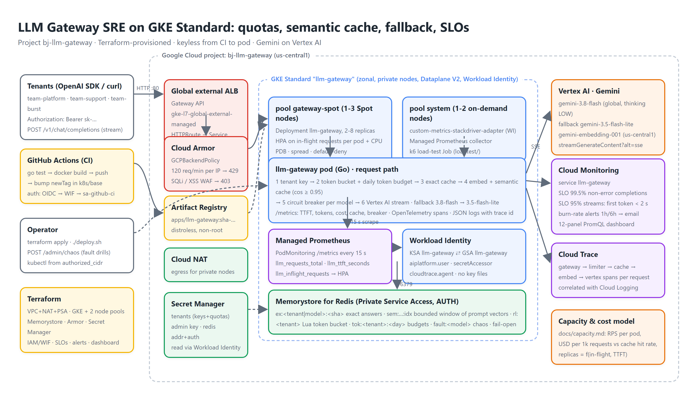

# LLM Gateway SRE on GKE Standard: quotas, semantic cache, fallback, SLOs

[](demo/demo.mp4)

A production-style **LLM gateway** in Go in front of **Vertex AI Gemini**, run the way an SRE team would run it on
**GKE Standard**: per-tenant API keys and quotas from Secret Manager, an exact + semantic **Redis cache**
(Memorystore), **model fallback behind circuit breakers**, **Prometheus** metrics that drive **SLOs** and a
**custom-metric HPA**, **OpenTelemetry** traces in Cloud Trace, **Cloud Armor** at the edge, a **k6** load profile,
and a written **capacity and cost model**. Terraform for every resource; keyless from CI to pod.

- Demo video: [`demo/demo.mp4`](demo/demo.mp4) · captions [`demo/captions.srt`](demo/captions.srt) · transcript [`demo/transcript.md`](demo/transcript.md)
- Docs site: [`docs/index.html`](docs/index.html) · capacity model: [`docs/capacity.md`](docs/capacity.md)
- Project: `bj-llm-gateway` · zone `us-central1-a` · Gemini from the `global` Vertex AI location
- **Rebuild from scratch, step by step (incl. org-policy override, second apply for SLOs, teardown): [`REBUILD.md`](REBUILD.md)**

## What the gateway does

OpenAI-compatible, so every client library works unchanged:

| Endpoint | Purpose |
|---|---|
| `POST /v1/chat/completions` | Chat, `stream: true` for SSE. Headers back: `x-cache` (miss / exact / semantic), `x-model-served`, `x-ratelimit-*`, `x-budget-*`, `x-request-id`. |
| `GET /v1/models` | Models the tenant may use, with fallback and list price. |
| `POST /admin/chaos` | Fault injection per model (`error` or `latency`, timed) to rehearse fallback and breakers. `x-admin-key`. |
| `GET /healthz` · `GET /readyz` | Liveness; readiness = Redis reachable and tenants loaded. |
| `GET /metrics` · `GET /version` | Prometheus exposition; build version. |

Request path, in order: **tenant key** (SHA-256 lookup; keys live in Secret Manager and are re-read every
minute) → **token bucket** per tenant (Lua in Redis, shared by all replicas) → **daily token budget** →
**exact cache** (SHA-256 of messages+params, namespaced per tenant and model) → **semantic cache** (embed the
last user message with `gemini-embedding-001`, cosine ≥ 0.95 against a bounded window of recent prompts, same
namespace) → **circuit breaker** per model → **Vertex AI** `streamGenerateContent` with `thinkingLevel: LOW`
→ on 429/5xx/timeout, **fallback** `gemini-3.8-flash → gemini-3.5-flash-lite` (never after the first byte has
been sent) → metrics, cost, budget, cache write.

Design choices worth defending in an interview:

- **Fail open on Redis.** A cache outage degrades cost controls (limits off, cache miss), never availability. The failures are counted (`llm_limiter_errors_total`) and dashboarded.
- **Cache per tenant.** One tenant can never be served another tenant's answer, even for an identical prompt. The price is a lower hit rate; the alternative is a data-leak.
- **No silent downgrade.** A tenant asking for a model it is not allowed gets 403, not the fallback.
- **Quota rejections are "good" for the SLO.** 429 is correct behaviour; only gateway/provider failures burn budget.
- **Scale on in-flight requests, not CPU.** A pod waiting on a model is idle for CPU but full for connections.

## Architecture

```
Tenant ──HTTP──► Global external ALB (Gateway API) ── Cloud Armor (120 req/min per IP, SQLi/XSS) ──► Service
                                                                                                        │
GKE Standard (zonal, private nodes, Dataplane V2, Workload Identity)                                    ▼
  pool system (on-demand):  custom-metrics-stackdriver-adapter, Managed Prometheus, k6 Job       llm-gateway pods (Spot pool, HPA 2-8)
  llm-gateway ── WI ──► Vertex AI (gemini-3.8-flash / 3.5-flash-lite / embedding-001)                  │
              ──────► Memorystore Redis (PSA): ex:* sem:* rl:* tok:*                                    │
              ──────► Secret Manager (tenants, admin key, redis)                                        │
              ──────► Cloud Trace (OTel spans)                                                          ▼
Managed Prometheus ──► Cloud Monitoring: SLO 99.5% non-error, SLO 95% TTFT < 2 s, burn-rate alerts, dashboard
                   ──► custom metrics API ──► HPA (llm_inflight_requests per pod)
GitHub Actions ──OIDC/WIF──► Artifact Registry ── bump newTag ──► ./deploy.sh rollout
```

## Repository layout

```
gateway/            Go service + 13 unit tests (miniredis, fake provider), distroless Dockerfile
terraform/          apis, vpc (+NAT +PSA), gke (Standard zonal, system + Spot pools, node SA), redis (Memorystore),
                    armor (throttle + WAF), iam (app GSA/WI, adapter GSA/WI, WIF + CI SA, build SA), secrets
                    (tenant keys, admin key, redis conn), registry, monitoring (SLOs, alerts, dashboard), outputs
k8s/base/           namespace (PSS restricted), serviceaccount (WI), deployment (Spot toleration, hardened),
                    service, hpa (custom metric + cpu), pdb, networkpolicy (default-deny), podmonitoring,
                    gateway + httproute, healthcheckpolicy, backendpolicy (Cloud Armor, 300 s timeout)
k8s/adapter/        how the custom-metrics-stackdriver-adapter is installed (deploy.sh does it)
loadtest/           k6.js (warm cache / unique streaming / burst tenant), in-cluster Job, run.sh
.github/workflows/  ci.yml: test → build → push → bump tag (keyless via WIF)
cloudbuild.yaml     bootstrap build with sa-build (first image before CI exists)
deploy.sh           terraform → image → kubeconfig → adapter → kubectl apply -k → gateway IP   (rollout | slo modes)
teardown.sh         k8s objects → terraform destroy → LB leftovers → destroy again → audit
demo/               recorder.py + scenes.py: automated demo video with Cloud Text-to-Speech narration
docs/               architecture diagram (HTML + PNG), docs site, capacity.md
```

## Deploy

```bash
cp terraform/terraform.tfvars.example terraform/terraform.tfvars   # project_id, your IP, alert email
./deploy.sh                 # ~25 min; first apply reports the two SLOs as "Cannot find metric" (expected)
loadtest/run.sh             # 2-minute k6 profile inside the cluster; watch the HPA scale
./deploy.sh slo             # second apply: SLOs + burn-rate alerts now that the metrics exist
```

Then:

```bash
IP=$(kubectl -n llm-gateway get gateway external -o jsonpath='{.status.addresses[0].value}')
KEY=$(terraform -chdir=terraform output -json tenant_keys | jq -r '."team-platform"')
curl -sN http://$IP/v1/chat/completions -H "Authorization: Bearer $KEY" -H 'content-type: application/json' \
  -d '{"model":"gemini-3.8-flash","stream":true,"messages":[{"role":"user","content":"What is an error budget?"}]}'
```

See [`REBUILD.md`](REBUILD.md) for verification, the fault drill, Cloud Armor checks and CI setup.

## Observability, SLOs and autoscaling

- `PodMonitoring` every 15 s → Managed Prometheus → Cloud Monitoring (`prometheus.googleapis.com/<metric>/<kind>`).
- Custom service `llm-gateway`, rolling 28 days:
  - **Availability:** 99.5% of chat completions without `upstream_error` / `internal_error`.
  - **TTFT:** 95% of streamed responses deliver the first token within 2 s (cache hits count; they are the point).
- **Burn-rate alerts** per SLO: 1 h window > 14.4× or 6 h window > 6×, emailed.
- **Dashboard** (12 PromQL panels): TTFT p50/p95, requests/s by outcome, tokens/s by model, cache hit ratio,
  cost USD/hour by tenant, rate-limited/s, upstream codes, breaker state + fallbacks, in-flight vs replicas,
  p95 by model, semantic score, limiter errors.
- **HPA:** `prometheus.googleapis.com|llm_inflight_requests|gauge`, target 4 in-flight per pod, 2-8 replicas,
  plus CPU 70% as a floor. Scale-out adds Spot nodes through the cluster autoscaler.
- **Traces:** one span per request with child spans `limiter.allow`, `cache.exact`, `vertex.embed`,
  `cache.semantic`, `vertex.streamGenerateContent` (`first_token` event); logs carry the trace id.

## Security

- **Keyless everywhere:** Workload Identity for the pod (`aiplatform.user`, `secretmanager.secretAccessor` on three secrets, `cloudtrace.agent`, `logging.logWriter`), Workload Identity Federation for CI, a dedicated node SA with five roles, nothing in a Kubernetes Secret.
- **Edge:** Cloud Armor per-IP throttle and preconfigured SQLi/XSS WAF rules via `GCPBackendPolicy`.
- **Cluster:** private nodes + Cloud NAT, control plane limited to `authorized_cidr`, Dataplane V2, Shielded nodes, namespace at Pod Security `restricted`.
- **Pod:** non-root, read-only root filesystem, all capabilities dropped, seccomp RuntimeDefault, no service-account token mount, resource limits, PDB.
- **NetworkPolicy:** default-deny; ingress from the load balancer, the Prometheus collector and the k6 job only; egress to DNS, the GKE metadata server, Google APIs on 443 and Redis on 6379 only.
- **Tenant isolation:** hashed keys in memory, cache namespaces per tenant and model, quotas per tenant.

## Cost and cleanup

Zonal Standard cluster (no management fee under the free tier), one on-demand plus one to three Spot
e2-standard-2 nodes, Memorystore Basic 1 GB, the global LB, NAT and the Armor policy come to roughly
₹400-500 per day; Gemini usage for the demo and load tests is a few rupees. Run it only for the demo:

```bash
./teardown.sh        # k8s objects → terraform destroy → Gateway LB leftovers → destroy again → audit
```

## Design notes (interview talking points)

- **Standard vs Autopilot:** Standard gives node pools (Spot for stateless pods, on-demand for add-ons), the cluster autoscaler, and room for DaemonSets or privileged tooling; Autopilot (project 2) removes node ops and bills per pod. Both run Workload Identity, GMP and Dataplane V2.
- **Why a gateway at all:** one place for keys, quotas, caching, fallback, cost attribution and golden signals, instead of every team re-implementing them against the provider API.
- **Semantic cache trade-offs:** threshold 0.95 on a 256-dim embedding; brute-force over a bounded window is exact and cheap at demo scale, and the embedding call (~100-200 ms) is paid only on exact-cache misses. Past a few thousand prompts per namespace, move the index to Memorystore for Valkey vector search.
- **Circuit breaker + fallback:** after five retryable failures in 30 s the primary is skipped for 30 s, then probed with one request. Fallback is decided before the first byte; a stream that dies mid-way is reported as an upstream error, not retried (the client already has partial output).
- **TTFT as the SLI:** for streamed LLM responses the user feels time-to-first-token, not total latency; total latency is dominated by the answer length the client asked for.
- **Cost model:** `docs/capacity.md` derives USD per 1k requests as a function of cache hit rate and model mix, and replicas as a function of in-flight requests and TTFT, from the k6 numbers.

## How I built this

Code, Terraform and the demo pipeline were written with Claude Code and verified against the real project:
`go test`, `terraform validate`/`apply`, live curl through the Gateway, the k6 run, the HPA scaling, the Cloud
Armor 403/429s, the fault drill and the SLO pages in Cloud Monitoring.
